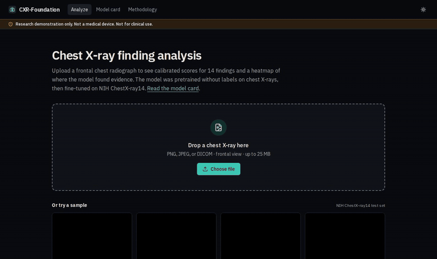
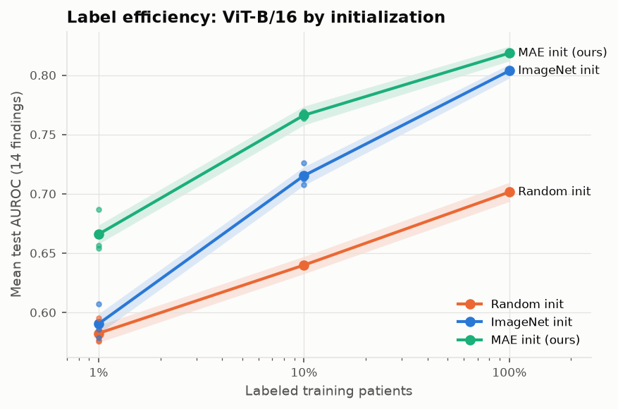

# CXR-Foundation

**A chest X-ray model pretrained without labels, evaluated like a clinical study, and served in a production-quality web app.**

> ⚠️ Research demonstration only. Not a medical device. Not for clinical use.

<!-- demo:start -->


**▶ [Full walk-through video (39 s, captioned)](docs/demo.mp4)**: upload, heatmaps, viewer tools,
model card, results. <sub>Recorded from the Dockerized app by `web/scripts/record-demo.mjs`;
sample image from the NIH ChestX-ray14 test set.</sub>
<!-- demo:end -->

## The problem

Labeling chest X-rays requires radiologists, so labels are scarce and expensive, while unlabeled
images are plentiful. Most medical imaging models start from ImageNet weights learned on everyday
photos. **Does pretraining on unlabeled chest X-rays instead let a model learn more from fewer
labels?** And can such a model be served with honest uncertainty, explanations, and guardrails?

## Approach

| Stage | What | Why it matters |
|---|---|---|
| Data | 112,120 NIH ChestX-ray14 images, **patient-level** splits (tested for leakage), decoded once into GPU-resident uint8 arrays | Image-level splits leak patients and inflate scores; the GPU never waits on 8 CPU cores |
| Self-supervised pretraining | **Masked Autoencoder (ViT-B/16) trained from scratch** on unlabeled NIH images (test set excluded) | Learns chest anatomy without any diagnosis labels |
| Label-efficiency study | Same ViT-B fine-tuned from random, ImageNet, and MAE weights with **1%, 10%, 100%** of labeled patients; 3 seeds with independent patient subsets | The question the project is built to answer |
| Baselines | DenseNet-121 and ResNet-50, random vs ImageNet init, 224 and 512 px | Anchors results against the standard CheXNet-style recipe |
| Evaluation | Per-finding AUROC/AUPRC with **patient-clustered bootstrap CIs**, paired comparisons, calibration (ECE, temperature scaling), PA vs AP stratification | Honest uncertainty; NIH test patients have up to 184 images each |
| Robustness | External validation on Stanford CheXpert (radiologist-labeled validation set), heatmap localization vs radiologist boxes (NIH) and **pixel-level segmentations from another hospital** (CheXlocalize), **shortcut audit** (do pneumothorax predictions rely on chest drains?) | Where models usually fail quietly |
| Serving | ONNX bundle with calibrated thresholds, **exact in-graph class activation maps**, out-of-distribution guard; FastAPI + Next.js | One forward pass gives scores, 14 heatmaps and an "is this a chest X-ray?" check |

## Results

<!-- results:start -->
_Auto-generated by `scripts/report.py` from evaluation artifacts._



| Mean test AUROC (95% CI) | 1% labels | 10% labels | 100% labels |
|---|---:|---:|---:|
| Random init | 0.582 (0.575–0.589) | 0.640 (0.633–0.647) | 0.701 (0.693–0.710) |
| ImageNet init | 0.590 (0.582–0.599) | 0.715 (0.707–0.723) | 0.804 (0.797–0.809) |
| MAE init (ours) | 0.666 (0.658–0.674) | 0.766 (0.758–0.774) | 0.819 (0.812–0.824) |

- Best CNN baseline by validation score (`sup_densenet121_imagenet_512`): test mean AUROC 0.815 (0.809–0.822).
- Shortcut audit (`sup_densenet121_imagenet_512`): pneumothorax AUROC is 0.904 with a chest drain vs 0.811 without (gap +0.093, 95% CI +0.067 to +0.122).
- External validation (`sup_densenet121_imagenet_512`, CheXpert validation set from Stanford, 202 frontal images, 6 scored findings): mean AUROC 0.831 (0.799–0.866).
- Heatmap localization (`sup_densenet121_imagenet_512`, CheXlocalize radiologist segmentations): pointing game 0.587 (0.531–0.646) vs 0.285 for always pointing at the image center.
<!-- results:end -->

Full tables, figures, and per-finding numbers: **[RESULTS.md](RESULTS.md)**. Every number there is
generated from saved evaluation artifacts by a script; none are typed by hand.

## The app

- **Upload** PNG, JPEG or DICOM (windowing, MONOCHROME1 inversion handled; patient fields never
  read). Files are sniffed by content, size-limited, processed in memory, and never stored.
- **Viewer** with zoom, pan, true window/level, invert, fullscreen and keyboard shortcuts;
  per-finding heatmap overlay with opacity control.
- **Findings panel** with calibrated probabilities, decision thresholds chosen on validation data,
  plain-language explanations, and test AUROC with CIs in tooltips.
- **Guardrails:** non-radiographs, lateral views, and atypical images (Mahalanobis distance in
  feature space) trigger a warning and hide scores unless the user explicitly reveals them.
- **Model card** served live from the deployed bundle; **methodology** page with the
  label-efficiency chart.
- WCAG 2.1 AA (axe-checked in CI, dark and light themes), responsive to tablet and phone.

## Run it

```bash
# 1. Get a model bundle into ./models/current (either):
uv run python -m cxr_ml.export.bundle <run> --out models/current   # from your own training run
uv run scripts/make_test_bundle.py models/current                   # tiny untrained test bundle
# 2. Launch API + web app:
docker compose up --build            # -> http://localhost:3000   (GPU: add -f docker-compose.gpu.yml)
```

Reproduce the research (single GPU; data paths in `.env.example`; step-by-step guide with
measured run times in [docs/REPRODUCE.md](docs/REPRODUCE.md)):

```bash
uv sync
uv run scripts/download_nih.py --out /data/cxr/raw/nih && uv run scripts/prep_nih.py
uv run python -m cxr_ml.train.mae --config configs/mae/vit_base.yaml        # ~13 h on one L40S
scripts/pipeline.sh                                                         # baselines + fine-tuning grid
scripts/analysis.sh                     # CheXpert, localization, shortcut audit, served model, report
```

CheXpert and VinDr-CXR require license agreements and are not downloaded automatically;
`uv run scripts/check_data.py` shows exactly where to place them. The CheXpert validation images
come from the CheXpert Plus release and their labels from CheXlocalize's radiologist
segmentations (CheXlocalize segmented every finding positive in the CheXpert ground truth, so a
finding is positive iff it was segmented). Then run `uv run scripts/prep_external.py`.

## Documentation

| Doc | What's in it |
|---|---|
| [RESULTS.md](RESULTS.md) | Every result with CIs: baselines, MAE, label efficiency, CheXpert, localization, shortcut audit, galleries |
| [docs/MODEL_CARD.md](docs/MODEL_CARD.md) | The served model: intended use, per-finding metrics and thresholds, external validation, limitations |
| [docs/ARCHITECTURE.md](docs/ARCHITECTURE.md) | System design, train/serve contract, request flow, testing |
| [docs/REPRODUCE.md](docs/REPRODUCE.md) | Data placement, every command, measured run times |
| [docs/API.md](docs/API.md) | Endpoints, response format, errors, configuration |
| [docs/data_report.md](docs/data_report.md) | Dataset statistics and split checks |

## Engineering

- **Monorepo:** `packages/cxr_common` (shared NumPy preprocessing and the bundle schema — the
  same code prepares training data and serves requests), `cxr_ml` (PyTorch), `cxr_server`
  (FastAPI + ONNX Runtime, **no PyTorch dependency**), `web` (Next.js 16, TypeScript strict,
  Tailwind v4, Radix/shadcn-style components).
- **Typed contract:** the web client's types are generated from the API's OpenAPI schema; CI fails
  if they drift.
- **Verified explainability:** the in-graph heatmaps are tested to match MONAI's independent
  Grad-CAM implementation (`monai.visualize.GradCAM`) on DenseNet-121 and ResNet, and to average
  exactly to the model's logits for CNNs and ViTs.
- **Reproducibility:** pinned dependencies, seeded everything, config + git commit + data split
  digest saved with every checkpoint, resumable training, ONNX/PyTorch numerical parity test.
- **CI:** ruff, mypy (strict for server and shared code), pytest, ESLint, tsc, Vitest, Playwright
  end-to-end with axe accessibility scans against the Docker stack, image builds.

## Limitations

- NIH labels were text-mined from reports and are noisy; test AUROC measures agreement with those
  labels, not with ground truth.
- Single-institution training data; see external validation for the domain-shift drop.
- Heatmaps are coarse (7×7 to 16×16 grids) and show where evidence lies in the model's features —
  they are not segmentations or proof of correct reasoning.
- The plausibility guard catches obvious misuse, not every inappropriate input.

## Data and licenses

Code: [MIT](LICENSE). Datasets and the images derived from them keep their own licenses:

NIH ChestX-ray14 (NIH Clinical Center; Wang et al., CVPR 2017) — demo samples are from its test
split. Chest-drain labels: NEATX (Jiménez-Sánchez et al., CC BY-NC-SA, not redistributed here).
CheXpert / CheXpert Plus and CheXlocalize (Stanford AIMI, Saporta et al., Nature Machine
Intelligence 2022) and VinDr-CXR (PhysioNet) are used under their own licenses; no images or
annotations are redistributed here, only aggregate metrics.
