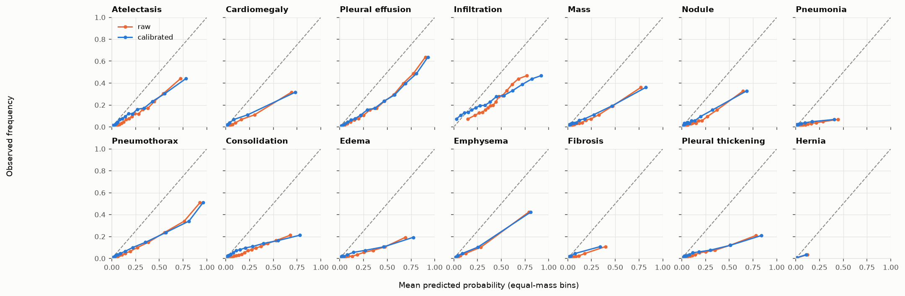
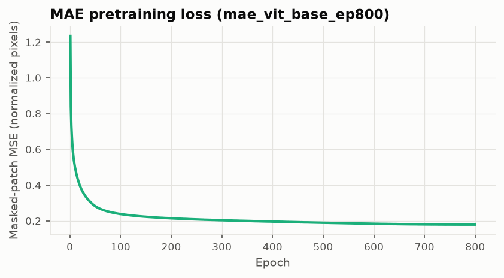
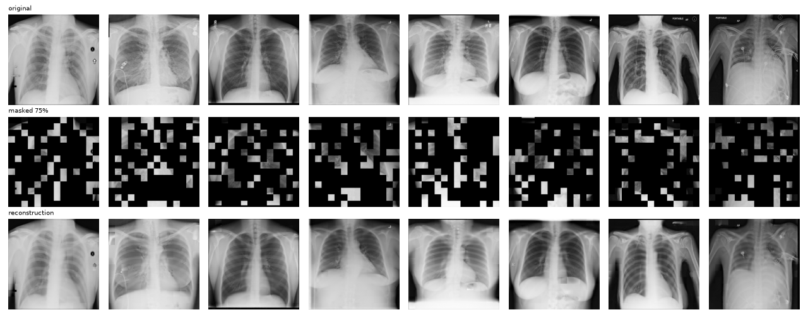
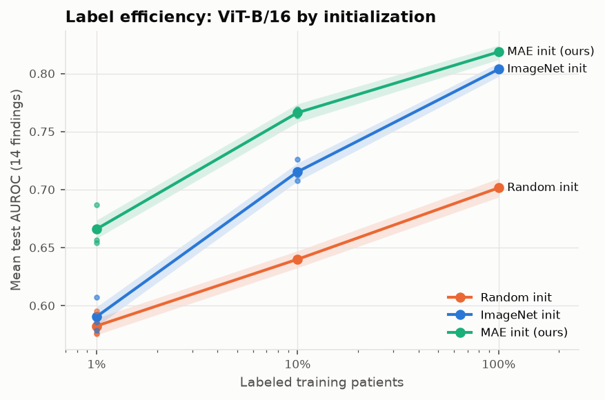

# Results

_Generated by `scripts/report.py` on 2026-11-11 08:37 UTC at commit `7d1d979` from evaluation artifacts in `$CXR_DATA_ROOT/artifacts/eval/`. Do not edit by hand; every number below is read from those files. "not run" means the artifact does not exist._

All AUROCs are on the NIH official test list (25,596 images, 2,797 patients) unless stated. Intervals are 95% patient-clustered bootstrap CIs (2,000 resamples, shared across runs so differences are paired).

## 1. Supervised baselines

| Model | Init | Input | Val mean AUROC | Test mean AUROC (95% CI) | Mean ECE raw → calibrated |
|---|---|---|---:|---:|---:|
| DenseNet-121 | ImageNet | 224 | 0.841 | 0.806 (0.799–0.812) | 0.116 → 0.092 |
| DenseNet-121 | random | 224 | 0.818 | 0.776 (0.769–0.783) | 0.125 → 0.087 |
| ResNet-50 | ImageNet | 224 | 0.833 | 0.800 (0.793–0.806) | 0.148 → 0.107 |
| ResNet-50 | random | 224 | 0.815 | 0.777 (0.770–0.783) | 0.110 → 0.077 |
| DenseNet-121 | ImageNet | 512 | 0.852 | 0.815 (0.809–0.822) | 0.108 → 0.078 |

Per-finding results for the baseline with the best **validation** score (`sup_densenet121_imagenet_512`):

| Finding | AUROC (95% CI) | AUPRC (95% CI) | Test prevalence | AUROC PA | AUROC AP |
|---|---:|---:|---:|---:|---:|
| Atelectasis | 0.772 (0.759–0.784) | 0.345 (0.321–0.369) | 12.8% | 0.787 | 0.761 |
| Cardiomegaly | 0.886 (0.869–0.901) | 0.336 (0.278–0.389) | 4.2% | 0.934 | 0.845 |
| Pleural effusion | 0.833 (0.823–0.843) | 0.520 (0.494–0.546) | 18.2% | 0.867 | 0.804 |
| Infiltration | 0.684 (0.673–0.694) | 0.386 (0.367–0.404) | 23.9% | 0.620 | 0.671 |
| Mass | 0.816 (0.796–0.835) | 0.302 (0.265–0.340) | 6.8% | 0.837 | 0.788 |
| Nodule | 0.784 (0.764–0.802) | 0.255 (0.224–0.288) | 6.3% | 0.791 | 0.769 |
| Pneumonia | 0.721 (0.698–0.744) | 0.052 (0.044–0.062) | 2.2% | 0.713 | 0.698 |
| Pneumothorax | 0.866 (0.853–0.880) | 0.431 (0.396–0.467) | 10.4% | 0.868 | 0.866 |
| Consolidation | 0.751 (0.735–0.766) | 0.165 (0.146–0.187) | 7.1% | 0.753 | 0.696 |
| Edema | 0.843 (0.825–0.861) | 0.174 (0.146–0.209) | 3.6% | 0.854 | 0.774 |
| Emphysema | 0.933 (0.924–0.943) | 0.437 (0.390–0.481) | 4.3% | 0.917 | 0.945 |
| Fibrosis | 0.831 (0.808–0.852) | 0.106 (0.084–0.133) | 1.7% | 0.780 | 0.845 |
| Pleural thickening | 0.798 (0.780–0.815) | 0.170 (0.149–0.196) | 4.5% | 0.771 | 0.804 |
| Hernia | 0.897 (0.830–0.950) | 0.367 (0.193–0.552) | 0.3% | 0.904 | 0.806 |

Mean AUROC by view: PA 0.814 (n=11,096), AP 0.791 (n=14,500).

## 2. MAE pretraining

- `mae_vit_base_ep800`: complete. 
  Reconstructions at epoch 0800 (val images; top: original, middle: 75% masked input, bottom: reconstruction): 

## 3. Label efficiency (headline)

| Initialization | 1% labels | 10% labels | 100% labels |
|---|---:|---:|---:|
| Random init | 0.582 (0.575–0.589), n_seeds=3 | 0.640 (0.633–0.647), n_seeds=3 | 0.701 (0.693–0.710), n_seeds=1 |
| ImageNet init | 0.590 (0.582–0.599), n_seeds=3 | 0.715 (0.707–0.723), n_seeds=3 | 0.804 (0.797–0.809), n_seeds=1 |
| MAE init (ours) | 0.666 (0.658–0.674), n_seeds=3 | 0.766 (0.758–0.774), n_seeds=3 | 0.819 (0.812–0.824), n_seeds=1 |

Points are means over seeds (each seed uses an independent patient subset); intervals are bootstrap CIs of that seed-averaged mean (test-sampling uncertainty). Seed spread is shown as dots in the figure.

Paired differences in mean AUROC (same bootstrap resamples):

| Comparison | Labels | Δ mean AUROC (95% CI) |
|---|---:|---:|
| MAE init (ours) − ImageNet init | 1% | +0.075 (+0.068 to +0.082) |
| MAE init (ours) − ImageNet init | 10% | +0.051 (+0.047 to +0.055) |
| MAE init (ours) − ImageNet init | 100% | +0.015 (+0.011 to +0.018) |
| MAE init (ours) − Random init | 1% | +0.083 (+0.076 to +0.092) |
| MAE init (ours) − Random init | 10% | +0.126 (+0.119 to +0.133) |
| MAE init (ours) − Random init | 100% | +0.117 (+0.110 to +0.123) |
| ImageNet init − Random init | 1% | +0.008 (-0.000 to +0.016) |
| ImageNet init − Random init | 10% | +0.075 (+0.069 to +0.081) |
| ImageNet init − Random init | 100% | +0.102 (+0.096 to +0.108) |

## 4. External validation (CheXpert)

`ft_vitb_imagenet_f100_s0` on CheXpert valid (202 frontal images, 200 patients; labels derived from CheXlocalize radiologist segmentations (a finding is positive iff radiologists segmented it)): mean AUROC over exact-mapped findings 0.792 (0.743–0.848)

| CheXpert finding | NIH output(s) | Positives | CheXpert AUROC (95% CI) | NIH test AUROC | Drop |
|---|---|---:|---:|---:|---:|
| Atelectasis | Atelectasis | 75 | 0.786 (0.719–0.848) | 0.765 (0.752–0.778) | -0.020 |
| Cardiomegaly | Cardiomegaly | 66 | 0.808 (0.743–0.867) | 0.882 (0.864–0.897) | +0.074 |
| Consolidation | Consolidation | 32 | 0.844 (0.774–0.902) | 0.751 (0.736–0.765) | -0.093 |
| Edema | Edema | 42 | 0.849 (0.781–0.911) | 0.848 (0.831–0.864) | -0.001 |
| Pleural Effusion | Effusion | 64 | 0.896 (0.851–0.936) | 0.818 (0.808–0.828) | -0.078 |
| Pneumonia | Pneumonia | 0 | not scored: unlabeled in this split | — | — |
| Pneumothorax | Pneumothorax | 7 | 0.567 (0.301–0.845) | 0.851 (0.833–0.868) | +0.284 |
| Lung Lesion (approx.) | Mass/Nodule | 1 | not scored: fewer than 5 positives | — | — |

`ft_vitb_random_f100_s0` on CheXpert valid (202 frontal images, 200 patients; labels derived from CheXlocalize radiologist segmentations (a finding is positive iff radiologists segmented it)): mean AUROC over exact-mapped findings 0.727 (0.675–0.794)

| CheXpert finding | NIH output(s) | Positives | CheXpert AUROC (95% CI) | NIH test AUROC | Drop |
|---|---|---:|---:|---:|---:|
| Atelectasis | Atelectasis | 75 | 0.775 (0.707–0.838) | 0.686 (0.670–0.700) | -0.089 |
| Cardiomegaly | Cardiomegaly | 66 | 0.698 (0.617–0.773) | 0.757 (0.734–0.777) | +0.058 |
| Consolidation | Consolidation | 32 | 0.807 (0.726–0.877) | 0.701 (0.685–0.716) | -0.107 |
| Edema | Edema | 42 | 0.800 (0.721–0.874) | 0.811 (0.792–0.829) | +0.011 |
| Pleural Effusion | Effusion | 64 | 0.762 (0.690–0.829) | 0.741 (0.727–0.754) | -0.021 |
| Pneumonia | Pneumonia | 0 | not scored: unlabeled in this split | — | — |
| Pneumothorax | Pneumothorax | 7 | 0.516 (0.265–0.856) | 0.721 (0.698–0.744) | +0.205 |
| Lung Lesion (approx.) | Mass/Nodule | 1 | not scored: fewer than 5 positives | — | — |

`ft_vitb_ssl_f100_s0` on CheXpert valid (202 frontal images, 200 patients; labels derived from CheXlocalize radiologist segmentations (a finding is positive iff radiologists segmented it)): mean AUROC over exact-mapped findings 0.833 (0.787–0.880)

| CheXpert finding | NIH output(s) | Positives | CheXpert AUROC (95% CI) | NIH test AUROC | Drop |
|---|---|---:|---:|---:|---:|
| Atelectasis | Atelectasis | 75 | 0.815 (0.752–0.871) | 0.780 (0.767–0.792) | -0.035 |
| Cardiomegaly | Cardiomegaly | 66 | 0.819 (0.758–0.875) | 0.897 (0.880–0.911) | +0.078 |
| Consolidation | Consolidation | 32 | 0.918 (0.878–0.955) | 0.756 (0.741–0.769) | -0.162 |
| Edema | Edema | 42 | 0.909 (0.853–0.955) | 0.860 (0.844–0.875) | -0.050 |
| Pleural Effusion | Effusion | 64 | 0.867 (0.815–0.914) | 0.840 (0.830–0.849) | -0.027 |
| Pneumonia | Pneumonia | 0 | not scored: unlabeled in this split | — | — |
| Pneumothorax | Pneumothorax | 7 | 0.670 (0.412–0.906) | 0.864 (0.848–0.878) | +0.194 |
| Lung Lesion (approx.) | Mass/Nodule | 1 | not scored: fewer than 5 positives | — | — |

`sup_densenet121_imagenet_224` on CheXpert valid (202 frontal images, 200 patients; labels derived from CheXlocalize radiologist segmentations (a finding is positive iff radiologists segmented it)): mean AUROC over exact-mapped findings 0.782 (0.745–0.827)

| CheXpert finding | NIH output(s) | Positives | CheXpert AUROC (95% CI) | NIH test AUROC | Drop |
|---|---|---:|---:|---:|---:|
| Atelectasis | Atelectasis | 75 | 0.789 (0.725–0.849) | 0.764 (0.750–0.776) | -0.025 |
| Cardiomegaly | Cardiomegaly | 66 | 0.838 (0.779–0.892) | 0.881 (0.861–0.896) | +0.043 |
| Consolidation | Consolidation | 32 | 0.844 (0.785–0.898) | 0.730 (0.714–0.746) | -0.114 |
| Edema | Edema | 42 | 0.749 (0.655–0.836) | 0.841 (0.823–0.857) | +0.092 |
| Pleural Effusion | Effusion | 64 | 0.843 (0.787–0.892) | 0.822 (0.811–0.833) | -0.021 |
| Pneumonia | Pneumonia | 0 | not scored: unlabeled in this split | — | — |
| Pneumothorax | Pneumothorax | 7 | 0.630 (0.478–0.833) | 0.864 (0.848–0.878) | +0.234 |
| Lung Lesion (approx.) | Mass/Nodule | 1 | not scored: fewer than 5 positives | — | — |

`sup_densenet121_imagenet_512` on CheXpert valid (202 frontal images, 200 patients; labels derived from CheXlocalize radiologist segmentations (a finding is positive iff radiologists segmented it)): mean AUROC over exact-mapped findings 0.831 (0.799–0.866)

| CheXpert finding | NIH output(s) | Positives | CheXpert AUROC (95% CI) | NIH test AUROC | Drop |
|---|---|---:|---:|---:|---:|
| Atelectasis | Atelectasis | 75 | 0.843 (0.788–0.895) | 0.772 (0.759–0.784) | -0.071 |
| Cardiomegaly | Cardiomegaly | 66 | 0.781 (0.710–0.846) | 0.886 (0.869–0.901) | +0.105 |
| Consolidation | Consolidation | 32 | 0.911 (0.869–0.947) | 0.751 (0.735–0.766) | -0.160 |
| Edema | Edema | 42 | 0.864 (0.797–0.922) | 0.843 (0.825–0.861) | -0.021 |
| Pleural Effusion | Effusion | 64 | 0.832 (0.770–0.886) | 0.833 (0.823–0.843) | +0.001 |
| Pneumonia | Pneumonia | 0 | not scored: unlabeled in this split | — | — |
| Pneumothorax | Pneumothorax | 7 | 0.756 (0.624–0.915) | 0.866 (0.853–0.880) | +0.110 |
| Lung Lesion (approx.) | Mass/Nodule | 1 | not scored: fewer than 5 positives | — | — |

`sup_densenet121_random_224` on CheXpert valid (202 frontal images, 200 patients; labels derived from CheXlocalize radiologist segmentations (a finding is positive iff radiologists segmented it)): mean AUROC over exact-mapped findings 0.742 (0.705–0.788)

| CheXpert finding | NIH output(s) | Positives | CheXpert AUROC (95% CI) | NIH test AUROC | Drop |
|---|---|---:|---:|---:|---:|
| Atelectasis | Atelectasis | 75 | 0.764 (0.696–0.829) | 0.744 (0.729–0.757) | -0.020 |
| Cardiomegaly | Cardiomegaly | 66 | 0.779 (0.710–0.842) | 0.884 (0.866–0.900) | +0.106 |
| Consolidation | Consolidation | 32 | 0.875 (0.816–0.928) | 0.736 (0.719–0.751) | -0.139 |
| Edema | Edema | 42 | 0.764 (0.685–0.834) | 0.830 (0.811–0.846) | +0.065 |
| Pleural Effusion | Effusion | 64 | 0.855 (0.801–0.904) | 0.816 (0.805–0.826) | -0.039 |
| Pneumonia | Pneumonia | 0 | not scored: unlabeled in this split | — | — |
| Pneumothorax | Pneumothorax | 7 | 0.415 (0.255–0.624) | 0.814 (0.795–0.831) | +0.399 |
| Lung Lesion (approx.) | Mass/Nodule | 1 | not scored: fewer than 5 positives | — | — |

`sup_resnet50_imagenet_224` on CheXpert valid (202 frontal images, 200 patients; labels derived from CheXlocalize radiologist segmentations (a finding is positive iff radiologists segmented it)): mean AUROC over exact-mapped findings 0.785 (0.733–0.847)

| CheXpert finding | NIH output(s) | Positives | CheXpert AUROC (95% CI) | NIH test AUROC | Drop |
|---|---|---:|---:|---:|---:|
| Atelectasis | Atelectasis | 75 | 0.811 (0.747–0.868) | 0.760 (0.745–0.773) | -0.051 |
| Cardiomegaly | Cardiomegaly | 66 | 0.844 (0.788–0.898) | 0.880 (0.860–0.897) | +0.036 |
| Consolidation | Consolidation | 32 | 0.840 (0.773–0.900) | 0.724 (0.708–0.739) | -0.116 |
| Edema | Edema | 42 | 0.774 (0.697–0.848) | 0.833 (0.815–0.851) | +0.059 |
| Pleural Effusion | Effusion | 64 | 0.869 (0.820–0.916) | 0.821 (0.810–0.831) | -0.049 |
| Pneumonia | Pneumonia | 0 | not scored: unlabeled in this split | — | — |
| Pneumothorax | Pneumothorax | 7 | 0.573 (0.288–0.870) | 0.856 (0.842–0.871) | +0.283 |
| Lung Lesion (approx.) | Mass/Nodule | 1 | not scored: fewer than 5 positives | — | — |

`sup_resnet50_random_224` on CheXpert valid (202 frontal images, 200 patients; labels derived from CheXlocalize radiologist segmentations (a finding is positive iff radiologists segmented it)): mean AUROC over exact-mapped findings 0.763 (0.716–0.815)

| CheXpert finding | NIH output(s) | Positives | CheXpert AUROC (95% CI) | NIH test AUROC | Drop |
|---|---|---:|---:|---:|---:|
| Atelectasis | Atelectasis | 75 | 0.746 (0.676–0.812) | 0.744 (0.729–0.756) | -0.002 |
| Cardiomegaly | Cardiomegaly | 66 | 0.827 (0.770–0.881) | 0.891 (0.875–0.905) | +0.064 |
| Consolidation | Consolidation | 32 | 0.836 (0.761–0.901) | 0.734 (0.718–0.750) | -0.103 |
| Edema | Edema | 42 | 0.745 (0.663–0.820) | 0.828 (0.810–0.844) | +0.083 |
| Pleural Effusion | Effusion | 64 | 0.840 (0.784–0.890) | 0.811 (0.799–0.822) | -0.029 |
| Pneumonia | Pneumonia | 0 | not scored: unlabeled in this split | — | — |
| Pneumothorax | Pneumothorax | 7 | 0.582 (0.393–0.818) | 0.820 (0.803–0.836) | +0.238 |
| Lung Lesion (approx.) | Mass/Nodule | 1 | not scored: fewer than 5 positives | — | — |

## 5. Heatmap localization

Pointing game: fraction of annotated findings where the heatmap's maximum falls inside the radiologist's box (NIH, VinDr) or segmentation (CHEXLOCALIZE: CheXpert validation images, an external hospital). A heatmap is only informative if it beats the image-center and random-point baselines. The center baseline is high on CHEXLOCALIZE because large, central Cardiomegaly masks are a quarter of its items. Attention rollout is class-agnostic; for ImageNet-initialized ViTs its peak often sits on background patches near the image corners (attention-sink tokens, see Darcet et al. 2023, 'Vision Transformers Need Registers'), which is why it can score below the random-point baseline.

| Run | Reference | Heatmap | n | Pointing game (95% CI) | Center baseline | Random baseline | Mean IoU |
|---|---|---|---:|---:|---:|---:|---:|
| `ft_vitb_imagenet_f100_s0` | CHEXLOCALIZE | cam | 288 | 0.257 (0.205–0.309) | 0.292 | 0.089 | 0.071 |
| `ft_vitb_imagenet_f100_s0` | CHEXLOCALIZE | rollout | 288 | 0.017 (0.003–0.035) | 0.292 | 0.089 | 0.032 |
| `ft_vitb_imagenet_f100_s0` | NIH | cam | 984 | 0.274 (0.246–0.302) | 0.218 | 0.080 | 0.084 |
| `ft_vitb_imagenet_f100_s0` | NIH | rollout | 984 | 0.010 (0.004–0.016) | 0.218 | 0.080 | 0.007 |
| `ft_vitb_random_f100_s0` | CHEXLOCALIZE | cam | 288 | 0.191 (0.146–0.240) | 0.292 | 0.089 | 0.056 |
| `ft_vitb_random_f100_s0` | CHEXLOCALIZE | rollout | 288 | 0.267 (0.219–0.319) | 0.292 | 0.089 | 0.087 |
| `ft_vitb_random_f100_s0` | NIH | cam | 984 | 0.113 (0.093–0.133) | 0.218 | 0.080 | 0.052 |
| `ft_vitb_random_f100_s0` | NIH | rollout | 984 | 0.208 (0.183–0.234) | 0.218 | 0.080 | 0.065 |
| `ft_vitb_ssl_f100_s0` | CHEXLOCALIZE | cam | 288 | 0.302 (0.250–0.354) | 0.292 | 0.089 | 0.139 |
| `ft_vitb_ssl_f100_s0` | CHEXLOCALIZE | rollout | 288 | 0.035 (0.014–0.059) | 0.292 | 0.089 | 0.003 |
| `ft_vitb_ssl_f100_s0` | NIH | cam | 984 | 0.265 (0.238–0.293) | 0.218 | 0.080 | 0.121 |
| `ft_vitb_ssl_f100_s0` | NIH | rollout | 984 | 0.016 (0.009–0.024) | 0.218 | 0.080 | 0.000 |
| `sup_densenet121_imagenet_224` | CHEXLOCALIZE | cam | 288 | 0.184 (0.142–0.233) | 0.292 | 0.089 | 0.126 |
| `sup_densenet121_imagenet_224` | NIH | cam | 984 | 0.280 (0.254–0.310) | 0.218 | 0.080 | 0.174 |
| `sup_densenet121_imagenet_512` | CHEXLOCALIZE | cam | 288 | 0.587 (0.531–0.646) | 0.285 | 0.089 | 0.208 |
| `sup_densenet121_imagenet_512` | NIH | cam | 984 | 0.521 (0.489–0.551) | 0.215 | 0.079 | 0.219 |
| `sup_densenet121_random_224` | CHEXLOCALIZE | cam | 288 | 0.295 (0.243–0.347) | 0.292 | 0.089 | 0.145 |
| `sup_densenet121_random_224` | NIH | cam | 984 | 0.298 (0.269–0.326) | 0.218 | 0.080 | 0.166 |
| `sup_resnet50_imagenet_224` | CHEXLOCALIZE | cam | 288 | 0.444 (0.389–0.503) | 0.292 | 0.089 | 0.186 |
| `sup_resnet50_imagenet_224` | NIH | cam | 984 | 0.404 (0.374–0.435) | 0.218 | 0.080 | 0.184 |
| `sup_resnet50_random_224` | CHEXLOCALIZE | cam | 288 | 0.250 (0.198–0.302) | 0.292 | 0.089 | 0.104 |
| `sup_resnet50_random_224` | NIH | cam | 984 | 0.257 (0.231–0.286) | 0.218 | 0.080 | 0.148 |

## 6. Shortcut audit: pneumothorax and chest drains

AUROC for pneumothorax-positive images **with** vs **without** a chest drain, each against all test negatives. Drain labels: NEATX non-expert annotations (CC BY-NC-SA). A large positive gap means the model partly detects the treatment (drain) rather than the disease.

| Run | Positives with drain | Positives without drain | AUROC with drain | AUROC without drain | Gap (95% CI) |
|---|---:|---:|---:|---:|---:|
| `ft_vitb_imagenet_f100_s0` | 1021 | 739 | 0.898 (0.875–0.919) | 0.772 (0.740–0.803) | +0.126 (+0.092 to +0.162) |
| `ft_vitb_random_f100_s0` | 1021 | 739 | 0.747 (0.714–0.784) | 0.674 (0.644–0.705) | +0.073 (+0.035 to +0.112) |
| `ft_vitb_ssl_f100_s0` | 1021 | 739 | 0.897 (0.874–0.918) | 0.811 (0.784–0.838) | +0.086 (+0.057 to +0.118) |
| `sup_densenet121_imagenet_224` | 1021 | 739 | 0.923 (0.909–0.937) | 0.785 (0.751–0.815) | +0.138 (+0.107 to +0.172) |
| `sup_densenet121_imagenet_512` | 1021 | 739 | 0.904 (0.888–0.919) | 0.811 (0.783–0.835) | +0.093 (+0.067 to +0.122) |
| `sup_densenet121_random_224` | 1021 | 739 | 0.851 (0.827–0.873) | 0.759 (0.728–0.790) | +0.091 (+0.059 to +0.127) |
| `sup_resnet50_imagenet_224` | 1021 | 739 | 0.917 (0.901–0.932) | 0.769 (0.743–0.796) | +0.148 (+0.121 to +0.176) |
| `sup_resnet50_random_224` | 1021 | 739 | 0.861 (0.839–0.883) | 0.767 (0.738–0.794) | +0.094 (+0.063 to +0.127) |

## 7. Failure galleries

- [ft vitb ssl f100 s0  cardiomegaly errors](docs/figures/galleries/ft_vitb_ssl_f100_s0__cardiomegaly_errors.png)
- [ft vitb ssl f100 s0  effusion errors](docs/figures/galleries/ft_vitb_ssl_f100_s0__effusion_errors.png)
- [ft vitb ssl f100 s0  mass errors](docs/figures/galleries/ft_vitb_ssl_f100_s0__mass_errors.png)
- [ft vitb ssl f100 s0  pneumothorax drains](docs/figures/galleries/ft_vitb_ssl_f100_s0__pneumothorax_drains.png)
- [ft vitb ssl f100 s0  pneumothorax errors](docs/figures/galleries/ft_vitb_ssl_f100_s0__pneumothorax_errors.png)
- [sup densenet121 imagenet 512  cardiomegaly errors](docs/figures/galleries/sup_densenet121_imagenet_512__cardiomegaly_errors.png)
- [sup densenet121 imagenet 512  effusion errors](docs/figures/galleries/sup_densenet121_imagenet_512__effusion_errors.png)
- [sup densenet121 imagenet 512  mass errors](docs/figures/galleries/sup_densenet121_imagenet_512__mass_errors.png)
- [sup densenet121 imagenet 512  pneumothorax drains](docs/figures/galleries/sup_densenet121_imagenet_512__pneumothorax_drains.png)
- [sup densenet121 imagenet 512  pneumothorax errors](docs/figures/galleries/sup_densenet121_imagenet_512__pneumothorax_errors.png)

