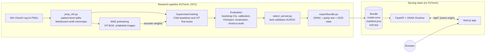
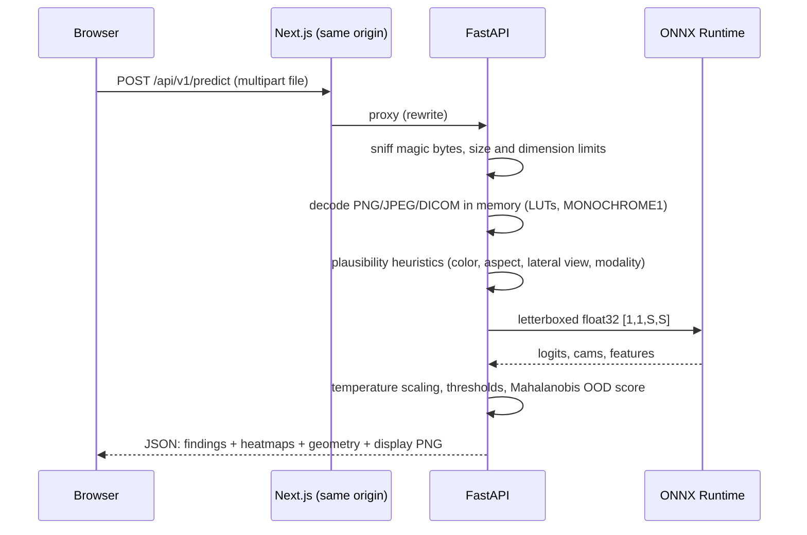

# Architecture

CXR-Foundation has two halves that share one contract: a **research pipeline** that trains and
evaluates models, and a **serving stack** that runs the chosen model. They meet in a *bundle*: a
directory holding an ONNX model plus everything needed to interpret its outputs.

## Packages

| Package | Depends on | Role |
|---|---|---|
| `packages/cxr_common` | NumPy, OpenCV, pydicom, Pydantic | Preprocessing (letterbox), DICOM to uint8, label definitions, bundle schema. Used by **both** training and serving, so preprocessing cannot drift. |
| `packages/cxr_ml` | PyTorch, timm | Data loading, models, MAE, training, evaluation, explainability, ONNX export. |
| `packages/cxr_server` | FastAPI, ONNX Runtime | Inference API. A CI job asserts that PyTorch is **not** installed in its environment. |
| `web/` | Next.js 16, React 19, Tailwind 4, Radix | Viewer, findings panel, model card and methodology pages. Types are generated from the API's OpenAPI schema. |

## Key design decisions

**One preprocessing path.** Images are letterboxed (long side scaled to the model size, then
zero-padded to a square) by `cxr_common.preprocess.letterbox`. The training memmaps, the external
datasets and every API request go through the same function, and intensity normalization lives
inside the model graph. The API also returns the letterbox geometry, so the browser can draw
heatmaps exactly over the original image.

**Data on the GPU.** The machine has 8 CPU cores, and PNG decoding tops out at about 615
images/s. Instead, all 112,120 images are decoded once into uint8 arrays (224 px: 5.6 GB, kept
in GPU memory; 512 px: 29 GB, memory-mapped). Augmentation is one batched affine `grid_sample`
on the GPU at about 27,000 images/s (`docs/benchmarks/loader.json`). There are no horizontal
flips, because chest anatomy is left/right asymmetric.

**Heatmaps from the same forward pass.** Both CNNs and ViTs end in global average pooling and a
linear layer (ViTs use `global_pool="avg"` with the final norm before pooling). Applying the
linear layer at every spatial position gives a class activation map whose mean is *exactly* the
logit. So one ONNX call returns scores, 14 heatmaps and the pooled embedding. The maps are tested
against MONAI's independent Grad-CAM implementation (`tests/test_cam_vs_monai_gradcam.py`).

**Bundle as contract.** `cxr_common.bundle.Manifest` (Pydantic) describes the bundle: model id,
input size, heatmap grid, per-finding temperature (calibration) and decision threshold (chosen on
validation data), Mahalanobis out-of-distribution statistics, a model card whose numbers are
copied from evaluation artifacts, and provenance (git commit, config hash, split digest,
checkpoint hash). The export step refuses to write a bundle whose ONNX outputs differ from
PyTorch.

**Honest evaluation.**
- Splits, label-fraction subsets and bootstrap resamples are all at the **patient** level.
- Hyperparameters and the served model are chosen on validation data only.
- One fixed bootstrap seed is shared by every run, so differences between runs are paired.

## Request flow

- Uploads never touch disk. Starlette's multipart spooling is raised above the upload limit, and
  a test checks that no temporary file is created.
- Patient-identifying DICOM fields are never read or logged.
- Errors are RFC 7807 `application/problem+json` with a request id.
- Results live only in browser memory (React state, not storage).

## Testing and CI

| Layer | Tools |
|---|---|
| Python | pytest (splits, metrics vs. sklearn, models, MAE, ONNX export parity, CAM vs. MONAI, RLE decoding, CheXpert prep, API incl. PHI and no-disk checks), ruff, mypy (strict for server and shared code) |
| Web | ESLint, `tsc --noEmit`, Vitest (23 tests), Playwright end-to-end (18 tests, desktop + tablet) with axe WCAG 2.1 AA scans |
| Contract | OpenAPI schema exported from FastAPI; CI fails if the generated TypeScript types drift |
| Containers | CPU API image (751 MB, no PyTorch), web image (390 MB); end-to-end tests run against the composed stack |
