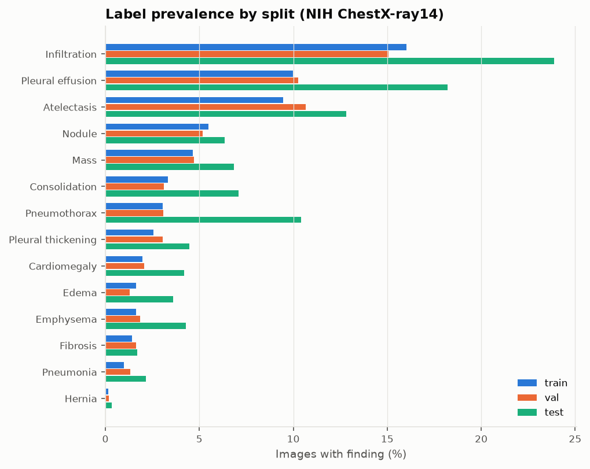
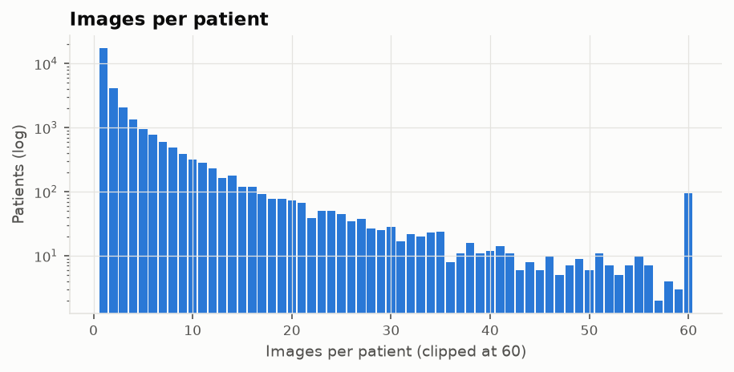

# NIH ChestX-ray14 — dataset report

_Generated by `scripts/data_report.py` from `index.parquet`; do not edit by hand._

Source: `repo=alkzar90/NIH-Chest-X-ray-dataset` @ `36778e3b0e4f`  
Split seed: 0 · val fraction of train_val patients: 0.1  
Split digest: `847757b25fa5e26b` · index digest: `bfa143ce455da5d7`

## Splits

| Split | Images | Patients | Images/patient (mean) | No finding |
|---|---:|---:|---:|---:|
| train | 78,146 | 25,207 | 3.10 | 58.40% |
| val | 8,378 | 2,801 | 2.99 | 58.03% |
| test | 25,596 | 2,797 | 9.15 | 38.53% |

Patient leakage check: **passed** (no patient appears in more than one split).

Label-fraction subsets (patient-level, nested, drawn from train):

| Fraction | Images | Patients |
|---|---:|---:|
| 1% | 783 | 256 |
| 10% | 7,816 | 2,557 |
| 100% | 78,146 | 25,207 |

## Class prevalence

| Finding | Train | Val | Test | Positives in 1% subset | Positives in 10% subset |
|---|---:|---:|---:|---:|---:|
| Atelectasis | 9.45% (7,388) | 10.65% (892) | 12.81% (3,279) | 67 | 689 |
| Cardiomegaly | 1.96% (1,535) | 2.05% (172) | 4.18% (1,069) | 26 | 161 |
| Pleural effusion | 9.98% (7,799) | 10.26% (860) | 18.20% (4,658) | 75 | 761 |
| Infiltration | 16.02% (12,519) | 15.08% (1,263) | 23.88% (6,112) | 127 | 1257 |
| Mass | 4.66% (3,640) | 4.70% (394) | 6.83% (1,748) | 33 | 362 |
| Nodule | 5.47% (4,275) | 5.17% (433) | 6.34% (1,623) | 52 | 430 |
| Pneumonia | 0.98% (764) | 1.34% (112) | 2.17% (555) | 10 | 59 |
| Pneumothorax | 3.04% (2,379) | 3.08% (258) | 10.41% (2,665) | 31 | 258 |
| Consolidation | 3.32% (2,592) | 3.10% (260) | 7.09% (1,815) | 14 | 240 |
| Edema | 1.63% (1,270) | 1.29% (108) | 3.61% (925) | 14 | 129 |
| Emphysema | 1.62% (1,267) | 1.86% (156) | 4.27% (1,093) | 14 | 148 |
| Fibrosis | 1.43% (1,114) | 1.64% (137) | 1.70% (435) | 12 | 110 |
| Pleural thickening | 2.54% (1,987) | 3.04% (255) | 4.47% (1,143) | 32 | 197 |
| Hernia | 0.16% (126) | 0.18% (15) | 0.34% (86) | 2 | 12 |

Note: the official test list differs from train/val: higher prevalence for most findings and 9.2 images per patient vs 3.1 in train (more follow-up studies per patient). AUROC is prevalence-invariant; AUPRC is not, so AUPRC should not be compared across splits.

Findings with fewer than 10 positives in the 1% subset: Hernia. Results for these in the 1% setting are dominated by noise.

## Images per patient

Median 1, 90th percentile 8, 99th percentile 35, max 184. Because some patients contribute dozens of images, confidence intervals resample patients, not images.

## View position, sex, age

| Split | PA | AP | Female | Male | Age median (IQR) |
|---|---:|---:|---:|---:|---|
| train | 64.75% | 35.25% | 44.06% | 55.94% | 48 (34–59) |
| val | 66.97% | 33.03% | 43.39% | 56.61% | 49 (35–60) |
| test | 43.35% | 56.65% | 41.86% | 58.14% | 49 (34–59) |

The test split is 56.65% AP vs 35.25% in train. AP films are typically portable bedside studies of sicker patients, so view position is a plausible confounder; RESULTS.md reports performance stratified by view.

## Known label caveats

- Labels were mined from radiology reports with NLP, not read from the images; the dataset authors report imperfect accuracy, and independent re-reads found substantial label noise for some classes. Test-set AUROC therefore measures agreement with noisy report-derived labels.
- *Infiltration* is a vague, inconsistently used term.
